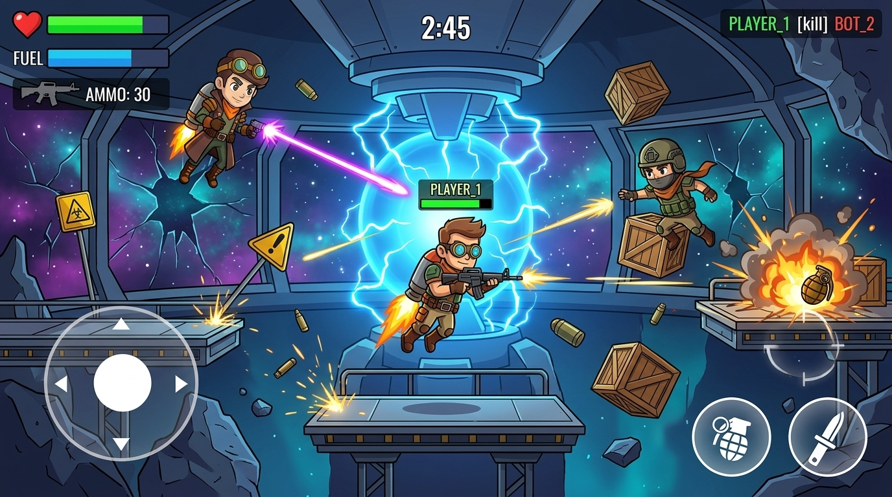

# 🚀 Doodle Army: Mini Militia Rebuild 2.0

A fast-paced, zero-lag 2D real-time multiplayer action shooter inspired by **Mini Militia (Doodle Army 2)**. Set in the subterranean asteroid space station **"Broken Space Outpost"**, players fight in mid-air with jetpacks, zero-g floating crates, pulsating anti-gravity core fields, and an arsenal of tactical weaponry.



---

## ⚡ Architecture & Monorepo Structure

```
├── /client          # Native C++17 Mobile & Desktop Game Client (Raylib + raygui + IXWebSocket)
│   ├── src/         # main.cpp, TouchControls, NetworkManager, GameWorld, Renderer
│   ├── include/     # Headers & single-header includes
│   ├── assets/      # Transparent weapon & character sprites
│   ├── android/     # AndroidManifest.xml & Raymob integration configuration
│   ├── CMakeLists.txt # Multi-platform CMake with FetchContent
│   └── README.md    # Desktop & Android APK build instructions
│
├── /server          # Authoritative Multiplayer Server (Node.js + Express + ws)
│   ├── src/         # index.js (WebSocket server), room.js, physics.js, bot.js, map.js, constants.js
│   ├── package.json # ws dependency, scripts, Render ready
│   └── README.md    # Cloud deployment instructions for Render
│
├── /client_web      # Original React + Vite Canvas Web Client (preserved)
└── /assets          # Game art assets, character sprites, and reference screenshots
```

---

## 🎯 Tech Stack Highlights

1. **Native Game Client (`/client` - C++17)**:
   - **Engine**: **Raylib 5.0** (with **raygui 4.0** for lobby menus) with 60–120 FPS performance.
   - **Networking**: **IXWebSocket** (`machinezone/IXWebSocket`) connecting via standard WebSockets (`ws://` / `wss://`) to the server.
   - **Serialization**: **`nlohmann/json`** for fast typed packet serialization.
   - **Mobile Controls**: Dual virtual on-screen touch joysticks (Left thumb: move & fly; Right thumb: 360° aim & auto-fire) + dedicated buttons for Reload & Grenade.
   - **Desktop Fallback**: Keyboard & mouse (`WASD`, Mouse aim/fire, `G` grenade, `R` reload).
   - **Cross-Platform Target**: Compiles seamlessly on Linux/Windows via CMake and on Android via **Raymob** (`Bigfoot71/raymob` Android Gradle/NDK template, locked to landscape orientation).

2. **Authoritative Multiplayer Server (`/server` - Node.js + `ws`)**:
   - **Engine**: Node.js + Express + standard **`ws`** library (zero socket.io handshake overhead for C++ clients).
   - **Physics Engine**: 60 ticks/s server simulation with AABB platform collisions, gravity, jetpack thrust, anti-gravity core field, bullet hitboxes, grenade bounce physics, and auto health regeneration.
   - **Render Ready**: Binds to `0.0.0.0` on `process.env.PORT || 4000`, includes `GET /` and `GET /health` probes, and handles 4-character room codes (`K9X2`).

---

## 🎮 Controls & Gameplay Mechanics

| Action | Desktop (Keyboard & Mouse) | Mobile (Dual Touch Joysticks) |
|---|---|---|
| **Move Left / Right** | `A` / `D` or `Left` / `Right` Arrow keys | Left Virtual Joystick (horizontal drag) |
| **Jetpack Flight** | `W` or `Spacebar` | Left Virtual Joystick (drag upwards into "FLY" zone) |
| **Aim Weapon** | Mouse cursor (360° rotation) | Right Virtual Joystick (360° aim pointer) |
| **Shoot** | **Left Mouse Button** (Hold to fire) | Right Virtual Joystick (drag past auto-fire threshold) |
| **Throw Grenade** | `G` or **Right Mouse Button** | Dedicated On-Screen **G** Button |
| **Reload Ammo** | `R` key | Dedicated On-Screen **RELOAD** Button |

### 🛠️ Arena & Combat Features
- **Anti-Gravity Core**: The giant blue pulsating energy orb in the center reduces gravity in its field, allowing extended flight and zero-g acrobatics.
- **Floating Physical Debris**: Tilted wooden crates and hazard signs provide tactical cover and deflect grenades.
- **Weapon Arsenal**:
  - 🔫 **Assault Rifle**: 30 rounds, rapid orange tracer bullets.
  - 💥 **Submachine Gun (SMG)**: 36 rounds, rapid high-speed spray.
  - 🎯 **Heavy Sniper**: 5 rounds, high damage cyan vapor trail.
  - 💥 **Combat Shotgun**: 6 shells, 5 fiery pellets per blast.
  - ⚡ **Laser Rifle**: 14 rounds, high-velocity purple piercing beam.
  - 💣 **Grenades**: Timed fuse, bouncy physics, and heavy AoE explosive radius.
  - ❤️ **Health Packs** & ⚡ **Fuel Tanks**: Immediate combat recovery.
- **Bot Combatants**: Jump in solo via **Quick Play** or host rooms with intelligent AI bots that navigate platforms, jetpack, aim, and shoot!

---

## 🛠️ Quick Start Guide

### 1. Run the Server
```bash
cd server
npm install
npm start
# Server starts on ws://localhost:4000 (or PORT env)
```

### 2. Build & Run the Native C++ Client (Desktop)
```bash
cd client
cmake -B build -DCMAKE_BUILD_TYPE=Release
cmake --build build -j$(nproc)
./build/MiniMilitiaNative
```

### 3. Build Android APK via Raymob
See [client/README.md](file:///home/asratul/Web%20Project/2d-battle-royle/client/README.md) for full instructions on cloning `Bigfoot71/raymob`, copying `client/src`, and running `./gradlew assembleRelease` to generate the `.apk`.

### 4. Deploying Server to Render (Free Cloud Hosting)
1. Push this repository to GitHub.
2. In [Render Dashboard](https://dashboard.render.com/), create a new **Web Service**.
3. Set **Root Directory** to `server`.
4. Set **Build Command** to `npm install` and **Start Command** to `npm start`.
5. Point your game client to `wss://your-app.onrender.com`.
